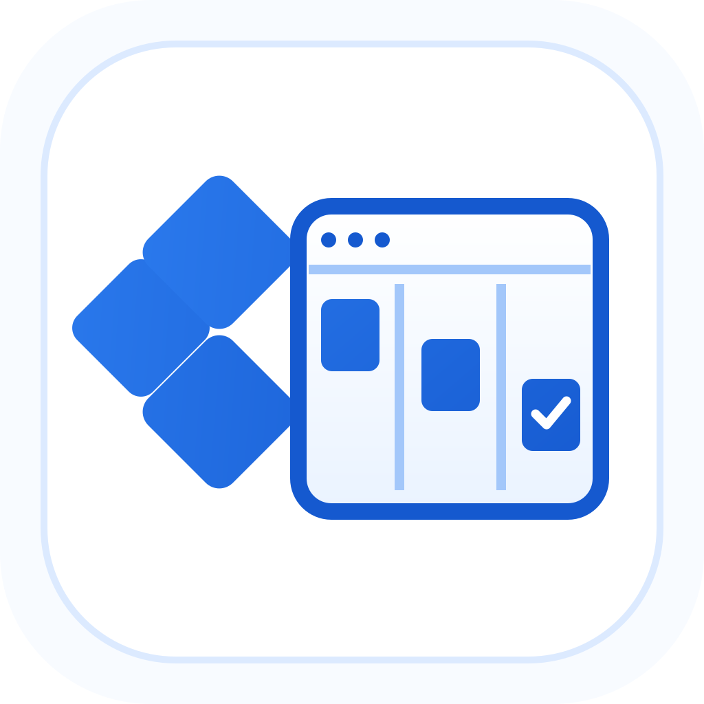

<!-- Modified for Orchestrator Board by Gama Software, 2026 (OB-1). -->

<div align="center">
  

### Orchestrator Board

#### Plan, run, and supervise coding agents from one place.

[](https://github.com/grzegorzrzeznikiewicz/orchestrator-board/stargazers)
[](https://github.com/grzegorzrzeznikiewicz/orchestrator-board/releases/latest)
[](https://github.com/grzegorzrzeznikiewicz/orchestrator-board/releases)
[](LICENSE)

Give every coding task its own agent, workspace, and feedback loop.<br />
Plan and delegate larger outcomes with a project-aware orchestrator.<br />
Follow every worker, pull request, CI run, and review in a live Kanban.

[**Install / release status**](#install) &nbsp;&bull;&nbsp; [Documentation](docs/README.md) &nbsp;&bull;&nbsp; [Fork releases](https://github.com/grzegorzrzeznikiewicz/orchestrator-board/releases) &nbsp;&bull;&nbsp; [Issues](https://github.com/grzegorzrzeznikiewicz/orchestrator-board/issues)

**English** · [简体中文](translations/README.zh-CN.md) · [日本語](translations/README.ja.md) · [한국어](translations/README.ko.md) · [Español](translations/README.es.md) · [Français](translations/README.fr.md) · [Deutsch](translations/README.de.md) · [Português (Brasil)](translations/README.pt-BR.md)

<br />

</div>

## A workspace for agent-driven development

One coding agent can handle a task. Running several across a project creates a different job: deciding what matters, splitting work cleanly, giving each agent the right context, preventing branch collisions, and following every change through review and merge.

Orchestrator Board is a local desktop workspace built for that job. Add a repository and create a worker session with the coding agent, model, and interface that fit the task. For Git-backed work, Orchestrator Board gives the worker its own branch and worktree. The task, conversation, terminal, changed files, browser preview, pull request, CI, and review state stay attached to that session from start to finish.

Behind the desktop app, Orchestrator Board's local daemon watches agent activity and source-control state. The result is a shared, live view of the project instead of a collection of disconnected terminals, branches, and browser tabs.

## Install

Orchestrator Board is the Gama Software fork of Agent Orchestrator. Signed production downloads have not yet been published for this fork. Use only [this fork’s releases](https://github.com/grzegorzrzeznikiewicz/orchestrator-board/releases) when builds become available; the original product’s releases are a different application.

For local development, follow [the development guide](docs/development.md). The desktop application is the intended distribution; the frozen upstream npm launcher is not an Orchestrator Board installer.

The fork keeps daemon data and projects under `~/.ao` (or `AO_DATA_DIR`). It uses a distinct application bundle and executable. See [fork identity, updates and data compatibility](docs/ob-10-fork-identity.md) before running alongside the original application. Do not replace an original installation with an unsigned development build.

## Workers execute focused tasks

A worker is Orchestrator Board's unit of execution: one task, one coding agent, and one isolated workspace. Use **New task** when the work is already clear. Describe the outcome, choose an agent and model, attach relevant files, and work with the agent in structured Chat or its native terminal UI.

Open a worker at any time to continue the conversation, attach to its terminal, inspect its changes, use its isolated browser, review its pull request, or send CI and review feedback back to the same agent. This makes each task independently understandable and keeps parallel work from collapsing into one shared context.


## The orchestrator plans across the project

The project orchestrator is Orchestrator Board's persistent planning and coordination agent. It works at the level above individual tasks: the product direction, technical strategy, priorities, and sequence of work across the repository.

Use the orchestrator to explore an idea before implementation, brainstorm product and technical approaches, reason through tradeoffs, identify high-impact work, and turn an ambiguous outcome into a concrete plan. Its project-scoped conversation preserves goals, decisions, constraints, and earlier reasoning. It combines that planning history with repository context and live Orchestrator Board state, including active workers, ownership, pull requests, CI, and reviews. This keeps planning grounded in both the project and the work already underway.

When a plan becomes actionable, the orchestrator can break it into focused tasks, spawn or redirect workers, pass each worker the relevant context, follow their progress, and coordinate follow-up work. The orchestrator owns planning and delegation; workers own implementation, tests, commits, and pull requests.


## The Kanban keeps the system legible

Every worker appears on the same live board, whether you started it from **New task** or the orchestrator delegated it. Orchestrator Board derives each card's position from session, pull request, CI, and review facts, turning the Kanban into an operational view of the project:

- **Working:** workers that are actively implementing or ready for another instruction
- **Needs you:** blocked sessions, missing input, failed CI, requested changes, or lost signals
- **In review:** open and draft pull requests waiting on checks or review
- **Ready to merge:** approved or mergeable work, with merged sessions kept visible until they are archived

Each card keeps the task, agent, branch, activity, pull request, and status together. Open it to inspect the conversation or terminal, changed files, PR summary, reviews, and preview. The board shows what is moving, what is blocked, and where your attention will have the most impact.


## One workflow, from idea to merge

1. **Start at the right level.** Give a clear task directly to a worker, or develop a larger outcome with the project orchestrator and let it shape the plan.
2. **Delegate focused work.** Start workers yourself or have the orchestrator create them with the context and ownership they need.
3. **Build in isolation.** Every Git-backed worker gets its own branch and worktree; standalone agents get Orchestrator Board-managed branchless directories without requiring a project or repository.
4. **Supervise live state.** Orchestrator Board follows agent activity, pull requests, CI, review feedback, and merge conflicts, then reflects those facts on the Kanban.
5. **Close the feedback loop.** Inspect any worker directly, make project-level decisions with the orchestrator, and return actionable failures or review comments to the agent that owns the work.

Orchestrator Board works with the coding agents and source-control workflow you already use. Agents keep their native strengths; Orchestrator Board supplies the project context, isolated execution, coordination, and operational view that make them work as a system.

## Product highlights

<table>
  <tr>
    <td width="36%" valign="middle">
      <h3>Pull requests and agent reviews</h3>
      <p>Keep CI, mergeability, reviewer state, and interactive agent reviews beside the worker, then return requested changes to the same owner.</p>
    </td>
    <td width="64%">
    </td>
  </tr>
  <tr>
    <td width="36%" valign="middle">
      <h3>Agent-controllable browser</h3>
      <p>Preview and inspect a worker's local app beside its interface. Temporary browser profiles are isolated per worker; named profiles deliberately reuse saved cookies and storage across sessions.</p>
    </td>
    <td width="64%">
    </td>
  </tr>
  <tr>
    <td width="36%" valign="middle">
      <h3>Native interfaces, one supervisor</h3>
      <p>Use structured Chat or the agent's native terminal UI while Orchestrator Board keeps task context, workspace state, and feedback in one place.</p>
    </td>
    <td width="64%">
    </td>
  </tr>
</table>

## Supported agents

**Coding agent harnesses in one supervised workflow.** Worker, Chat, and reviewer support differ; see the capability catalog linked below for the current matrix.

<table>
  <tr valign="middle">
    <td width="33%" valign="middle" nowrap> &nbsp; <b>Claude Code</b></td>
    <td width="33%" valign="middle" nowrap> &nbsp; <b>Codex</b></td>
    <td width="33%" valign="middle" nowrap><picture><source media="(prefers-color-scheme: dark)" srcset="frontend/src/renderer/assets/agents/cursor-dark.svg" /></picture> &nbsp; <b>Cursor</b></td>
  </tr>
  <tr valign="middle">
    <td valign="middle" nowrap><picture><source media="(prefers-color-scheme: dark)" srcset="frontend/src/renderer/assets/agents/opencode-dark.svg" /></picture> &nbsp; <b>opencode</b></td>
    <td valign="middle" nowrap> &nbsp; <b>Aider</b></td>
    <td valign="middle" nowrap><picture><source media="(prefers-color-scheme: dark)" srcset="frontend/src/renderer/assets/agents/copilot-dark.svg" /></picture> &nbsp; <b>GitHub Copilot</b></td>
  </tr>
  <tr valign="middle">
    <td valign="middle" nowrap><picture><source media="(prefers-color-scheme: dark)" srcset="frontend/src/renderer/assets/agents/grok-dark.svg" /></picture> &nbsp; <b>Grok</b></td>
    <td valign="middle" nowrap><picture><source media="(prefers-color-scheme: dark)" srcset="frontend/src/renderer/assets/agents/kimi-dark.svg" /></picture> &nbsp; <b>Kimi</b></td>
  </tr>
  <tr valign="middle">
    <td valign="middle" nowrap><picture><source media="(prefers-color-scheme: dark)" srcset="frontend/src/renderer/assets/agents/amp-dark.svg" /></picture> &nbsp; <b>Amp</b></td>
    <td valign="middle" nowrap><picture><source media="(prefers-color-scheme: dark)" srcset="frontend/src/renderer/assets/agents/auggie-dark.svg" /></picture> &nbsp; <b>Auggie</b></td>
    <td valign="middle" nowrap><picture><source media="(prefers-color-scheme: dark)" srcset="frontend/src/renderer/assets/agents/droid-dark.svg" /></picture> &nbsp; <b>Droid</b></td>
  </tr>
  <tr valign="middle">
    <td valign="middle" nowrap> &nbsp; <b>Crush</b></td>
    <td valign="middle" nowrap><picture><source media="(prefers-color-scheme: dark)" srcset="frontend/src/renderer/assets/agents/cline-dark.svg" /></picture> &nbsp; <b>Cline</b></td>
    <td valign="middle" nowrap><picture><source media="(prefers-color-scheme: dark)" srcset="frontend/src/renderer/assets/agents/goose-dark.svg" /></picture> &nbsp; <b>Goose</b></td>
  </tr>
  <tr valign="middle">
    <td valign="middle" nowrap><picture><source media="(prefers-color-scheme: dark)" srcset="frontend/src/renderer/assets/agents/qwen-dark.svg" /></picture> &nbsp; <b>Qwen</b></td>
    <td valign="middle" nowrap><picture><source media="(prefers-color-scheme: dark)" srcset="frontend/src/renderer/assets/agents/continue-dark.svg" /></picture> &nbsp; <b>Continue</b></td>
    <td valign="middle" nowrap><picture><source media="(prefers-color-scheme: dark)" srcset="frontend/src/renderer/assets/agents/devin-dark.svg" /></picture> &nbsp; <b>Devin</b></td>
  </tr>
  <tr valign="middle">
    <td valign="middle" nowrap> &nbsp; <b>Kiro</b></td>
    <td valign="middle" nowrap><picture><source media="(prefers-color-scheme: dark)" srcset="frontend/src/renderer/assets/agents/kilocode-dark.svg" /></picture> &nbsp; <b>Kilo Code</b></td>
    <td valign="middle" nowrap> &nbsp; <b>Vibe</b></td>
  </tr>
  <tr valign="middle">
    <td valign="middle" nowrap> &nbsp; <b>Muse</b></td>
    <td valign="middle" nowrap> &nbsp; <b>Agy</b></td>
  </tr>
  <tr valign="middle">
    <td valign="middle" nowrap> &nbsp; <b>Kimchi</b></td>
    <td valign="middle" nowrap> &nbsp; <b>OMP</b></td>
  </tr>
  <tr valign="middle">
    <td valign="middle" nowrap><picture><source media="(prefers-color-scheme: dark)" srcset="frontend/src/renderer/assets/agents/fx-dark.svg" /></picture> &nbsp; <b>fx</b></td>
    <td valign="middle" nowrap><picture><source media="(prefers-color-scheme: dark)" srcset="frontend/src/renderer/assets/agents/unreal-agent-dark.png" /></picture> &nbsp; <b>Unreal Agent</b></td>
    <td valign="middle" nowrap> &nbsp; <b>MiMo Code</b></td>
  </tr>
  <tr valign="middle">
    <td valign="middle" nowrap> &nbsp; <b>Gemini CLI</b></td>
    <td valign="middle" nowrap><picture><source media="(prefers-color-scheme: dark)" srcset="frontend/src/renderer/assets/agents/deepseek-harness-dark.svg" /></picture> &nbsp; <b>DeepSeek</b></td>
    <td valign="middle" nowrap><picture><source media="(prefers-color-scheme: dark)" srcset="frontend/src/renderer/assets/agents/opencode-dark.svg" /></picture> &nbsp; <b>OpenCode 2</b></td>
  </tr>
  <tr valign="middle">
    <td valign="middle" nowrap><picture><source media="(prefers-color-scheme: dark)" srcset="frontend/src/renderer/assets/agents/codewhale-dark.svg" /></picture> &nbsp; <b>Codewhale</b></td>
    <td valign="middle" nowrap><picture><source media="(prefers-color-scheme: dark)" srcset="frontend/src/renderer/assets/agents/command-code-dark.svg" /></picture> &nbsp; <b>Command Code</b></td>
    <td valign="middle" nowrap><picture><source media="(prefers-color-scheme: dark)" srcset="frontend/src/renderer/assets/agents/openhands-dark.svg" /></picture> &nbsp; <b>OpenHands</b></td>
  </tr>
</table>

[Browse agent setup guides →](frontend/src/docs/content/plugins/agents)

**Use the interface that fits the moment: structured Chat or the agent's native terminal UI.**

## Report a bug

[Open a bug report](https://github.com/grzegorzrzeznikiewicz/orchestrator-board/issues/new?template=bug_report.yml) from your own GitHub account. A few sentences in your own words about what you did and what went wrong are enough. Add what you expected, reproduction steps, your Orchestrator Board version and OS, or a screenshot if you have them; these are helpful, not prerequisites.

A local coding agent can help you clarify the report and gather evidence using the [bug-triage skill](.agents/skills/bug-triage/SKILL.md). Keep the issue body focused on your observations, with agent-collected logs, database excerpts, and investigation notes in separate attachments. Review any draft before submitting it under your own account. Please don't ask a bot to file issues on your behalf; reporter attribution matters.

See [contribution guidance](CONTRIBUTING.md#bugs-and-features) for help describing a problem.

## Develop and contribute

Contributions are welcome across code, docs, triage, examples, and tests.

```bash
git clone https://github.com/grzegorzrzeznikiewicz/orchestrator-board.git
cd orchestrator-board
```

Start with the [development guide](docs/development.md) for prerequisites, local setup, and test commands. Read [CONTRIBUTING.md](CONTRIBUTING.md) before opening a pull request, and use [GitHub Issues](https://github.com/grzegorzrzeznikiewicz/orchestrator-board/issues) for bugs and feature requests.

## Documentation

| Document                                                         | Start here when you need                                                                     |
| ---------------------------------------------------------------- | -------------------------------------------------------------------------------------------- |
| [Product documentation](frontend/src/docs/content)                  | Installation, agent setup, and day-to-day product usage.                                     |
| [docs/documentation-map.md](docs/documentation-map.md)           | Which docs are human-facing, which are machine-readable contracts, and which wins on drift.  |
| [docs/architecture.md](docs/architecture.md)                     | Backend mental model, lifecycle, persistence, CDC, status derivation, and daemon boundaries. |
| [docs/backend-code-structure.md](docs/backend-code-structure.md) | Package ownership and where each backend concern belongs.                                    |
| [docs/cli/README.md](docs/cli/README.md)                         | CLI behavior and daemon route mapping.                                                       |
| [docs/development.md](docs/development.md)                       | Prerequisites, build steps, running tests, and troubleshooting for local development.        |
| [docs/STATUS.md](docs/STATUS.md)                                 | What currently ships on `main` and what remains in flight.                                   |

## Community

Use [this fork’s GitHub Issues](https://github.com/grzegorzrzeznikiewicz/orchestrator-board/issues) for Orchestrator Board support. Upstream project history and attribution are retained in the source and bundled notices.

## Product telemetry

Product telemetry is designed to exclude your code, prompts, agent conversations, and credentials.\
Orchestrator Board collects limited usage and reliability telemetry to improve the product. [Learn what we collect and how to turn off desktop telemetry](docs/telemetry.md).

## License

Orchestrator Board is based on Agent Orchestrator, Copyright 2026 Untrivial, and retains the [Apache License 2.0](LICENSE). Gama Software branding identifies this fork; it does not replace upstream authorship or dependency licenses. See [the fork notice and packaged license inventory](docs/ob-10-fork-identity.md#licenses).
