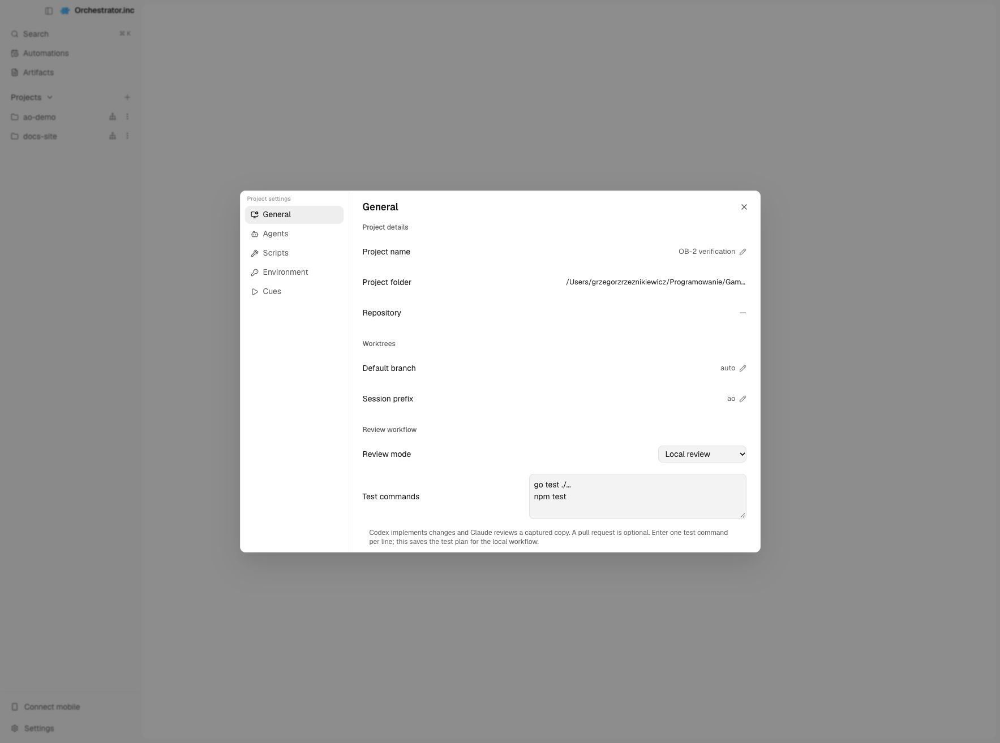

# OB-2 — raport odbioru

Data: 2026-10-15. Zadanie: [OB-2](https://gamasoftware.atlassian.net/browse/OB-2).

## Zrealizowany zakres

Projekt udostępnia tryb **Local review** obok dotychczasowego review PR. Zapisuje wybór wykonawcy Codex, recenzenta Claude oraz listę poleceń testów. Review uruchamia się bez URL PR/MR i otrzymuje niezależny snapshot plików, manifest, patch względem HEAD oraz oddzielne patche staged i unstaged.

Identyfikator SHA-256 uwzględnia HEAD, zawartość indeksu, ścieżki, treść, typ i uprawnienia wszystkich śledzonych i nieignorowanych nowych plików oraz usunięcia. Nie opiera się na liczbie linii ani rozmiarze pliku. Symlinki zapisuje jako tekst celu, bez odczytu plików spoza repozytorium. Nierozwiązane konflikty, submoduły i zagnieżdżone repozytoria są odrzucane z błędem.

## Kryteria i dowody

| Kryterium | Weryfikacja |
| --- | --- |
| Start bez PR/MR | `TestLocalReviewLaunchesWithoutPR` i `TestLocalReviewHTTPWithoutPRAndStaleResult`: rzeczywiste repozytorium bez remote, SQLite, silnik, usługa i HTTP. Tylko zewnętrzny proces agenta zastępuje launcher testowy. Test `SessionInspector` uruchamia akcję z zakładki Reviews bez PR, także przy odziedziczonej polityce auto-review PR. |
| Trwałość konfiguracji i identyfikatora | `TestLocalReviewAndConfigurationSurviveReopen` zamyka i otwiera prawdziwą bazę SQLite, sprawdzając role, polecenia testów, identyfikator snapshotu i unieważnienie. Test formularza zapisuje konfigurację i odtwarza ją po ponownym montażu. Podgląd przeglądarkowy potwierdza zapis i ponowny odczyt z izolowanej bazy. |
| Edycja, dodanie i usunięcie zmieniają identyfikator | `TestContentIdentity`: ta sama długość tekstu, staged, untracked, usunięcie, usunięcie staged, rename, binaria, bit wykonania, symlink i nazwy ze spacjami. `TestIdentityIgnoresUntrackedIgnoredAndMtime` odróżnia treść od samego mtime i ignorowanych plików. |
| Wcześniejszy wynik nie daje aktualnego zatwierdzenia | Test HTTP: approval jest aktualny przed zmianą, po zmianie ma `current=false`, trwałe unieważnienie i stan `needs_review`; ponowny submit jest odrzucany. `LocalReviewHistory` pokazuje stary werdykt wyłącznie jako historię. `ValidateLocalRun` stanowi bramkę aktualności dla późniejszej akceptacji użytkownika; OB-2 nie tworzy takiej akceptacji. |
| Wykonawca kończy edycję przed snapshotem | `TestLocalReviewRejectsActiveOrUnknownWorker`, `TestLocalReviewDoesNotLaunchIfWorkerResumesDuringPreflight`, `TestLocalReviewSerializesSnapshotWithNewWorkerDelivery`. Terminal i native chat współdzielą bramkę przygotowania. Nowe polecenie unieważnia wynik przed dostarczeniem wykonawcy; kolejka native chat blokuje nowy snapshot. |
| Zmiana podczas review uniemożliwia aktualny wynik | Niezależna kopia (`TestPrepareMakesIndependentSnapshot`), monotoniczne unieważnienie edit/revert, obserwacja pustych katalogów i ich metadanych, testy wyścigów HTTP bezpośrednio przed/po zapisie wyniku oraz testy z detektorem race. |
| Restart nie ożywia starego wyniku | Osobne testy dla rundy w toku i zakończonego approval. Utrata ciągłości obserwacji wymaga nowego review, zachowując zapisany identyfikator, konfigurację i historię. Lokalny reviewer nie jest odtwarzany ścieżką PR. |
| Migracja zachowuje PR review | `TestMigration0199PreservesPRReview`: baza w wersji 198 z istniejącym approval po migracji 199 zachowuje URL, SHA, status, werdykt i treść. Dotychczasowe testy silnika review, usługi, kontrolerów i magazynu również przechodzą. |
| Walidacja konfiguracji | `TestLocalReviewProjectConfig`: domyślny PR dla starych ustawień, domyślne role Local review, nieznany tryb, puste polecenia i NUL. Formularz potwierdza zapis ról i uporządkowanej listy poleceń. |

## Wykonane kontrole

- Pełne zestawy domeny, snapshotów, silnika review, usługi review, kontrolerów HTTP, CLI i całego SQLite: przechodzą, w tym wyścigi submitu i powtórne idempotentne przesłanie wyniku.
- `go test -race` dla testów lokalnego review w snapshotach, silniku i magazynie: przechodzi.
- Końcowy pełny backend `go test -p 2 ./...`: **201 pakietów przeszło, 0 błędów, 14 pakietów bez testów**. Wcześniejsze przebiegi przy dużej równoległości ujawniły niestabilne testy ograniczenia czasu adaptera OpenCode i przepełnienie kolejki odtwarzania ACP; oba pakiety przeszły przy ponownym wykonaniu. Brakującą zależność tmux rozwiązano przez PATH do istniejącej instalacji aplikacji. Nie zmieniano tych testów ani adapterów.
- Pełny frontend: 466 plików testowych przeszło; trzy pliki początkowo nie przeszły z powodu brakujących składników instalacji Electron/SQLite. Po instalacji tych składników ponowne wykonanie wszystkich trzech plików zakończyło się wynikiem **241/241**.
- Końcowe testy zmienionych komponentów, ustawień, helperów i pokrycia i18n: **236/236**.
- Build CLI/daemonu i vet zmienionych pakietów Go: przechodzą.
- Ponowne generowanie sqlc oraz OpenAPI/TypeScript nie zmienia hashy wygenerowanych plików. `git diff --check` przechodzi.
- Pełna kontrola typów TypeScript (`tsc --noEmit`) oraz końcowy przebieg inkrementalny po ostatnich poprawkach interfejsu: przechodzą bez diagnostyk.

## Podgląd interfejsu

W przeglądarce sprawdzono rzeczywisty formularz ustawień i jego zapis przez API do osobnej bazy. Nawigacja korzystała z przykładowego workspace dostępnego w trybie podglądu. Tymczasowe połączenie podglądu z daemonem zostało usunięte z kodu, a procesy podglądu zatrzymane. Nie używano produkcyjnej bazy `~/.ao`.

## Granice i zachowanie przy niepewności

- Polecenia testów są zapisywane jako plan; automatyczna pętla wykonania, poprawek i kolejnych review należy do OB-4. Rozbudowany protokół wyników należy do OB-3, a ekran akceptacji użytkownika do OB-6. Próba z rzeczywistymi agentami jest osobnym OB-7.
- Zmiana i przywrócenie treści nie przywraca ważności review. Restart unieważnia wcześniejsze wyniki, jeśli nie można potwierdzić ciągłości obserwacji.
- macOS może scalać szybkie create/delete. Dodatkowa kontrola metadanych katalogów wykrywa takie zdarzenia. Utworzenie lub usunięcie ignorowanego pliku może ostrożnościowo wymagać powtórzenia review; zwykła edycja istniejącego ignorowanego pliku i przypadkowe pliki Git `.lock` są odfiltrowane.
- Repozytorium bazuje na upstream [v0.14.2](https://github.com/OrchestratorInc/agent-orchestrator/releases/tag/v0.14.2), SHA `55b2962a5f7478fa7570777aad92f3bef3c99ccd`. Zachowano historię, licencję i lokalne AGENTS.md. Implementację zweryfikowano początkowo jako niezatwierdzone zmiany na `feature/OB-2`. Przy przygotowaniu MR, na osobne polecenie użytkownika, zaktualizowano tę samą gałąź do `main` forka (`df4cabc544dcbe2f0e4db5c8d6132ebb623a4d2b`), zachowując zmiany OB-2 i łącząc oba zestawy kluczy tłumaczeń. Repozytorium docelowe: https://github.com/grzegorzrzeznikiewicz/orchestrator-board. Nie używano dodatkowych worktree do realizacji zadania.
